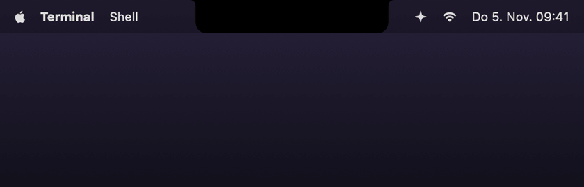
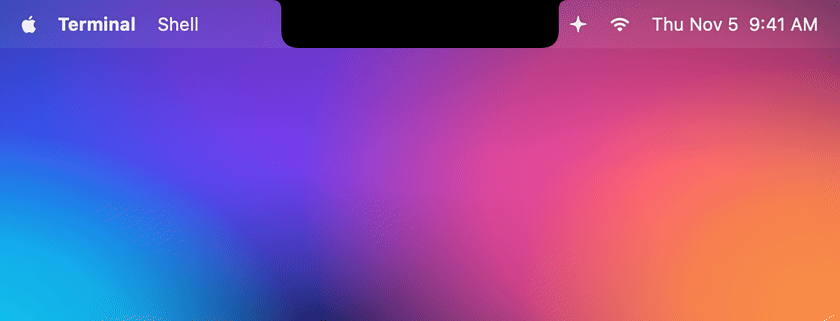
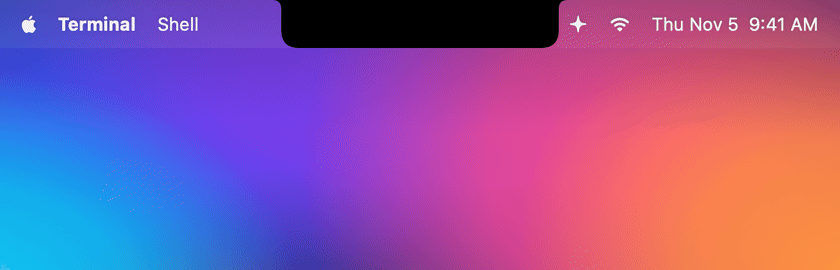
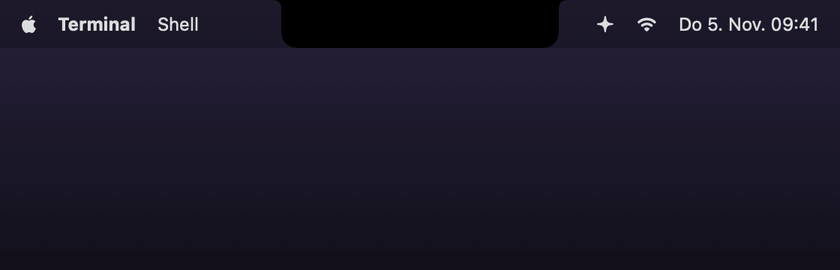
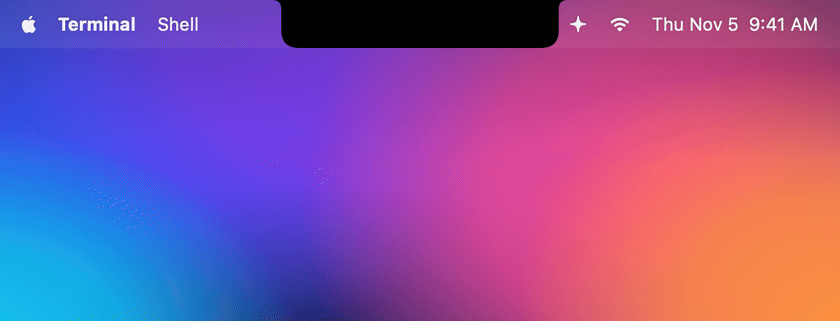
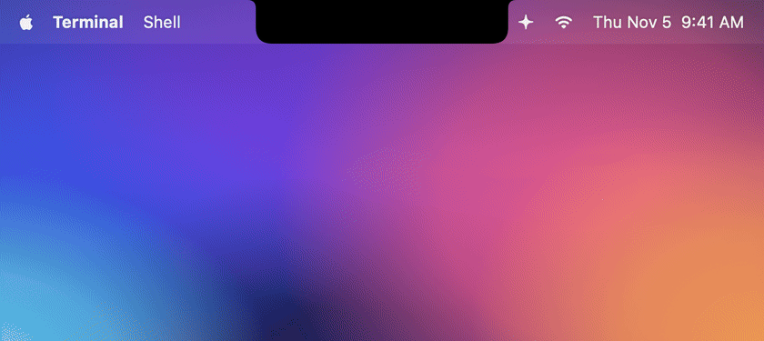
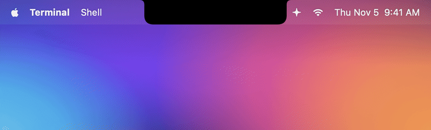
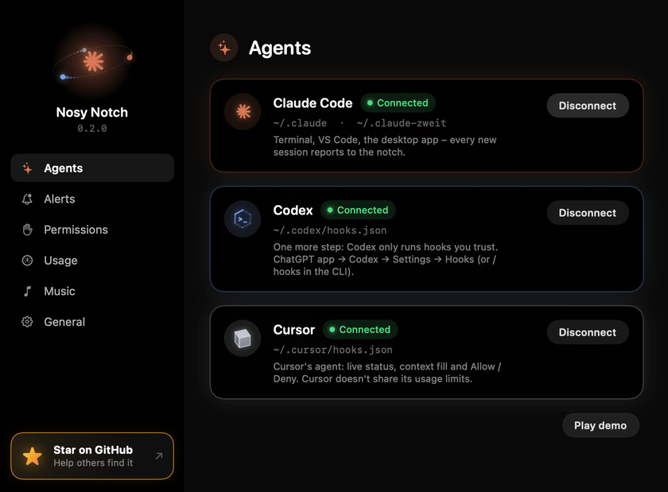

<h1 align="center">Nosy Notch</h1>

<p align="center">
  <b>Your MacBook notch keeps an eye on Claude Code, Codex and Cursor –<br>and plays your music while they take a break.</b>
</p>

<p align="center">
  
</p>

<p align="center">
  <code>npx nosynotch</code> · macOS 14+ · free · no account, no App Store, no Xcode
</p>

Coding agents spend a lot of time working on their own – and then sit there waiting for a "yes" you never saw.
Nosy Notch turns the black notch of your MacBook into a tiny status display: it slides open while an agent thinks,
shows which tool it's running, waves when it needs you, and throws confetti when it's done. You can approve a command
right there, with a click or a nod of your head. And when nothing is going on, the notch becomes a mini music player.

<table>
  <tr>
    <td align="center" width="50%"><br><b>Live status</b><br><sub>Thinking, the tool it's running, how long it's been</sub></td>
    <td align="center" width="50%"><br><b>Allow from the notch</b><br><sub>Deny · Always allow · Allow – or just nod</sub></td>
  </tr>
  <tr>
    <td align="center"><br><b>Done</b><br><sub>Checkmark, confetti and the gist of the answer</sub></td>
    <td align="center"><br><b>Didn't see it?</b><br><sub>A green dot waits until you look</sub></td>
  </tr>
  <tr>
    <td align="center"><br><b>Every session, every limit</b><br><sub>Hover for all sessions, context fill and usage limits</sub></td>
    <td align="center"><br><b>Music in between</b><br><sub>Spotify / Apple Music, with an equalizer that follows the beat</sub></td>
  </tr>
</table>

<p align="center"><a href="docs/animations.md"><b>→ Every animation, explained</b></a></p>

## Install

```bash
npx nosynotch
```

That one command downloads the app to `~/.nosynotch/`, connects every agent it finds and starts Nosy Notch in the
background – no Dock icon, just a ✦ in the menu bar. You need [Node.js](https://nodejs.org) 18+ for `npx`
(`brew install node` works too).

Two small things afterwards: restart Claude Code sessions that were already running, and – if you use Codex – trust the
new hooks once in Codex (ChatGPT app → **Codex → Settings → Hooks**, or `/hooks` in the CLI). Codex runs no hook you
haven't trusted.

<details>
<summary>More commands</summary>

```bash
npx nosynotch demo        # play every animation
npx nosynotch settings    # open the settings window
npx nosynotch status      # what is installed and running
npx nosynotch autostart   # start at login (autostart off to disable)
npx nosynotch stop
npx nosynotch uninstall   # removes app, hooks and autostart
```
</details>

## Works with

| | Live status | Allow / deny in the notch | Usage limits | Context fill |
|---|:---:|:---:|:---:|:---:|
| **Claude Code** – terminal, VS Code, desktop app | ✓ | ✓ | ✓ Pro / Max | ✓ |
| **Codex** – CLI and the ChatGPT app's Codex mode | ✓ | ✓ | ✓ | ✓ |
| **Cursor** – Cursor's agent | ✓ | ✓ commands outside its sandbox | – | ✓ |

Cursor doesn't share its usage limits with any hook, so that column stays empty for now.

Several sessions at once are no problem, mixed across agents. Each one gets a small badge and its own colour:
orange for Claude, blue for Codex, silver for Cursor. Macs without a notch get a virtual one in the middle of the menu bar.

## What the notch does

**While an agent works**, the notch slides out sideways: a spark spins on the left, the current tool on the right
(terminal, pencil, magnifier, globe …). Hover it to see every session with its status, a ring for how full its context
window is, and your 5-hour and weekly limits as bars. If a limit was at 80 % or more, the notch tells you the moment it resets.
A click on a session brings its terminal or app to the front.

**When it needs you**, the notch opens with an amber glow, shakes and shows the exact command. Click **Allow**,
**Deny** or **Always allow** – the agent carries on, no hunting for the right window. Claude Code keeps its own dialog
open at the same time, so you can answer wherever you are. With head gestures turned on, a nod with your AirPods allows
and a head shake denies.

**When it's done**, a checkmark draws itself, confetti flies and you get the start of the answer. Missed it? A small
green dot stays in the notch until you switch to that app or hover the list, and after five minutes you get one gentle
reminder. Already looking at the app? Then everything stays small and silent.

**When nothing's running**, Spotify or Apple Music takes over: cover on the left, equalizer on the right, a full player
on hover. The agents always win – the music comes back as soon as they're done.

## Settings



Click the ✦ in the menu bar → **Settings…**

- **Agents** – connect Claude Code, Codex and Cursor
- **Alerts** – sounds, mute for 1 h / 8 h / ∞, reminders
- **Permissions** – the notch buttons and head gestures
- **Usage** – which limits to show, a heads-up when a limit resets, context rings
- **Music** – player and the live equalizer

Mute is also right in the menu bar menu. Everything that needs a macOS permission (controlling your player, the live
equalizer, head gestures) is off until you turn it on – or asks only the first time you use it.

<br clear="right">

## Privacy

Everything stays on your Mac. The hooks talk to `127.0.0.1` only and nothing is uploaded. The only network requests
are for album covers (Spotify's public oEmbed with the track ID, Apple's iTunes Search with artist and title). The live equalizer analyses the
player's audio in memory and records nothing; head gestures only read motion while a request is open. Approvals are
protected by a secret in `~/.nosynotch/approval-token`, so no other process can answer in your name.

## How it works

```
Claude Code / Codex / Cursor ──hook (curl, ~15 ms)──▶ 127.0.0.1:7823 ──▶ Nosy Notch (SwiftUI panel over the notch)
```

All three agents have *hooks*: little commands they run at every step (prompt sent, tool started, permission needed,
done …). Nosy Notch adds a one-line `curl` that forwards each event to the app. If the app isn't running, `curl` fails
instantly and the agent carries on as if nothing happened – hooks never slow it down.

| | Where the hooks live | Extra |
|---|---|---|
| Claude Code | `settings.json` in `~/.claude`, `$CLAUDE_CONFIG_DIR` and every `~/.claude-*` account folder | Usage limits and context via a silent status line – only if you don't have your own |
| Codex | `~/.codex/hooks.json` | Limits and context from its session files |
| Cursor | `~/.cursor/hooks.json` | Prints `{}` so Cursor never waits on it – except `beforeShellExecution` for commands outside the sandbox, which waits for Allow / Deny |

The permission hook is the one exception that waits: it holds the request until you click in the notch. Answer in the
terminal instead, or let it time out, and the agent's own prompt takes over.

## Build from source

Requires macOS 14+ and the free Xcode Command Line Tools (`xcode-select --install`).

```bash
swift run                      # run directly
./scripts/build-app.sh --open  # build and open build/Nosy Notch.app
./scripts/record-gifs.sh       # re-record the GIFs in docs/gifs and the website videos (needs ffmpeg)
./scripts/record-gifs.sh done  # just one scene ("settings" = the settings window)
```

The recorder renders on a virtual clock, so no frame is ever dropped – a slow Mac just takes longer. Each scene
becomes a GIF for this README (30 fps, 840 px) and an MP4 + JPG poster in `website/public/demo/`. Options as
environment variables: `FPS=60` capture rate, `SCALE=3` for sharper 1680 px frames (default 2), `GIF_WIDTH` /
`GIF_FPS` / `GIF_COLORS`, `VIDEO=0` for GIFs only, `WEBM=1` for VP9 WebMs too, `STILLS=1` for PNG stills.

Releases: bump the version in `package.json` and `Resources/Info.plist`, push a tag `vX.Y.Z`. GitHub Actions builds a
universal binary, attaches it to the release and publishes to npm if the `NPM_TOKEN` secret is set.

<details>
<summary>Project layout</summary>

```
bin/nosynotch.js                     npx CLI (download, hooks, start/stop, autostart)
Sources/NosyNotch/
├── main.swift / AppDelegate.swift   app lifecycle, menu bar item, CLI flags
├── EventServer.swift                tiny HTTP server (Network.framework, loopback only)
├── HookEvent.swift                  hook JSON → event (Claude, Codex and Cursor dialects)
├── SessionStore.swift               event stream → state per session, unseen results, reminders
├── Session.swift                    states, agents, tool icons/labels, colours, error texts
├── HookInstaller.swift              hooks for Claude Code, Codex and Cursor
├── Approvals.swift                  permission requests waiting for Allow / Deny
├── HeadGestures.swift               nod / shake with AirPods
├── Usage.swift                      usage limits and context fill
├── NowPlaying.swift                 Spotify / Apple Music: track, cover, controls
├── AudioSpectrum.swift              live equalizer: Core Audio tap + FFT
├── Notifier.swift                   sounds, banners, mute, bringing the right app to the front
├── NotchViewModel.swift             what the notch shows and how big it is
├── NotchWindow.swift                transparent panel over the notch, hover without stealing clicks
├── Clock.swift                      wall clock, or a virtual one while recording
├── Recorder.swift                   GIF / video recorder (--record, --record-settings)
└── Views/                           notch shape, spark, confetti, media player, settings …
```
</details>

<sub>Not affiliated with Anthropic, OpenAI or Anysphere. Claude is a trademark of Anthropic, Codex and ChatGPT are
trademarks of OpenAI, Cursor is a trademark of Anysphere.</sub>
