# Alle Animationen

Jede Animation mit dem Claude-Code-Hook, der sie auslöst. Alle GIFs und Screenshots sind echte Aufnahmen
der App (`./scripts/record-gifs.sh`), nur der Desktop dahinter ist gestellt.
Standbilder mit ausgeklappter Notch: [Screenshots](#screenshots).

| | |
|---|---|
| [Denkt nach](#denkt-nach) · [Tool läuft](#tool-läuft) · [Braucht dich](#braucht-dich) · [Fertig](#fertig) | [Fehler](#fehler) · [Komprimiert](#komprimiert) · [Mehrere Sessions](#mehrere-sessions-hover) · [Kompletter Ablauf](#kompletter-ablauf) |

## Denkt nach

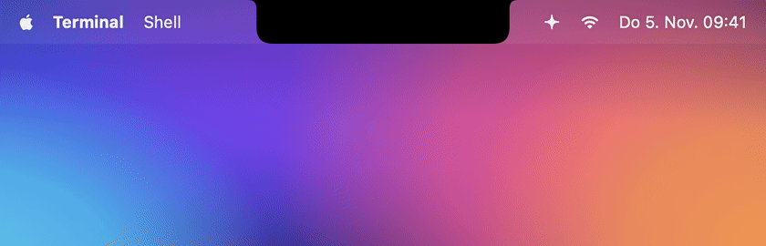

**Auslöser:** `UserPromptSubmit`, `PostToolUse`

Die Notch fährt seitlich aus. Links rotiert der Spark, seine Strahlen pulsieren als Welle, rechts hüpfen drei Punkte.

## Tool läuft


**Auslöser:** `PreToolUse`

Der Spark dreht schneller, rechts erscheint das Icon des Tools mit Puls:

| Tool | Icon | Tool | Icon |
|---|---|---|---|
| Bash | Terminal | Grep / Glob | Lupe / Ordner |
| Edit / Write | Stift | WebFetch / WebSearch | Globus / Kompass |
| Read | Dokument | Task / Agent | zwei Personen |
| TodoWrite | Checkliste | MCP-Tools | Puzzleteil |

In der Hover-Liste steht zusätzlich, *was* gerade passiert („Bearbeitet Parser.swift“, „Führt aus · Run tests“).

## Braucht dich


**Auslöser:** `PermissionRequest` (sofort, wenn der Erlaubnis-Dialog aufgeht) und `Notification`
(z. B. Rückfragen, MCP-Eingaben)

Die Notch klappt auf, glüht orange und schüttelt sich, die Hand winkt, dazu der Sound „Funk“. Sobald du
im Terminal antwortest, geht die Notch von allein wieder zu. Die Erinnerung „waiting for your input“, die
Claude Code ~60 s nach einem fertigen Turn schickt, wird bewusst ignoriert.

## Fertig


**Auslöser:** `Stop`

Häkchen zeichnet sich, Konfetti-Burst, grünes Glühen, Sound „Glass“. Angezeigt werden Projekt, Dauer
des Turns und der Anfang der letzten Antwort. Klick springt ins Terminal.

## Fehler

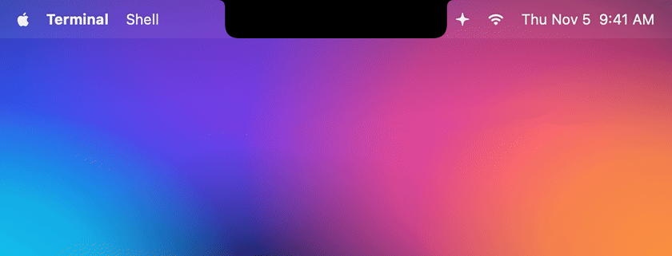

**Auslöser:** `StopFailure` (der Turn ist wegen eines API-Fehlers abgebrochen)

Rotes Glühen, ein flackernder Spark und ein kurz zuckendes Warndreieck, Sound „Basso“. Der Fehlercode
wird übersetzt:

| `error` | Anzeige |
|---|---|
| `rate_limit` | Rate-Limit erreicht |
| `overloaded` | API ist überlastet |
| `authentication_failed` | Anmeldung fehlgeschlagen |
| `billing_error` | Problem mit der Abrechnung |
| `server_error` | Serverfehler bei der API |
| `max_output_tokens` | Antwort hat das Token-Limit erreicht |
| … | API-Fehler + Details |

Fehlgeschlagene *Tools* (`PostToolUseFailure`, z. B. ein roter Test) lösen bewusst keinen Alarm aus:
Das ist normaler Arbeitsalltag, Claude macht danach einfach weiter.

## Komprimiert

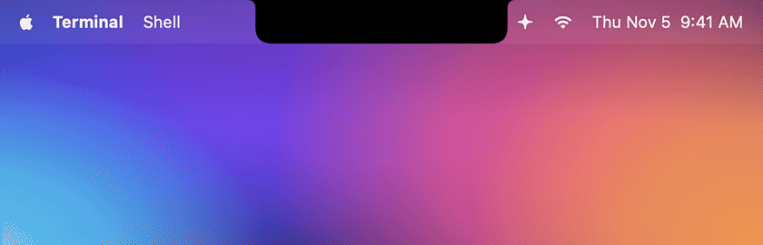

**Auslöser:** `PreCompact`

Violetter Spark, der sich gegenläufig dreht und zusammenzieht.

## Mehrere Sessions (Hover)

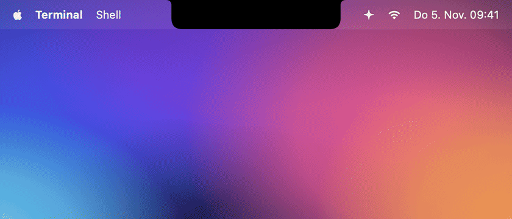

Maus über die Notch: Liste aller laufenden Sessions mit Status, aktuellem Tool und Timer. Ein Klick
holt das richtige Terminal nach vorn, ✕ entfernt eine Session aus der Liste. Bei mehreren Sessions
zeigt die kompakte Notch immer die wichtigste (Braucht dich / Fehler > Arbeitet > Fertig > Bereit).

## Kompletter Ablauf


Denken → Grep → Edit → Erlaubnis für Bash → Tests laufen → Fertig. Live vorführen lässt sich das mit
`npx claude-notch demo`.

## Screenshots

Ausgeklappte Notch als PNG (2×), z. B. für Blogposts oder die GitHub-Social-Preview. Liegen in
[`docs/screenshots/`](screenshots/).

| | |
|---|---|
| 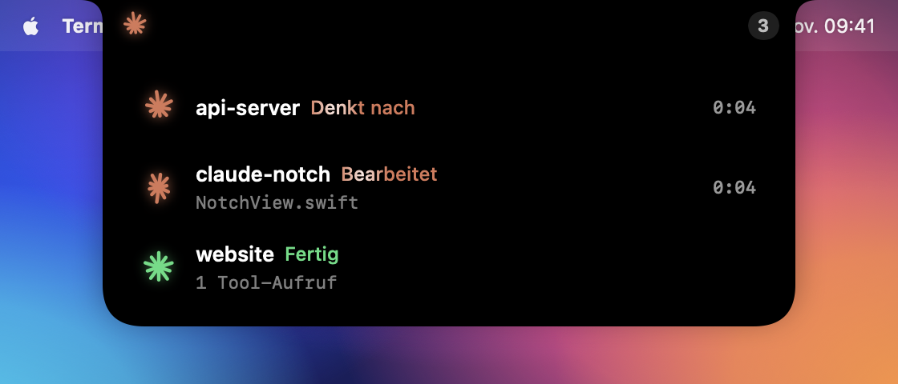 | 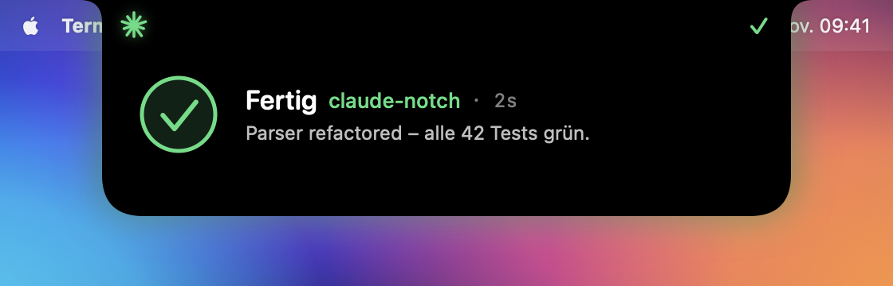 |
| 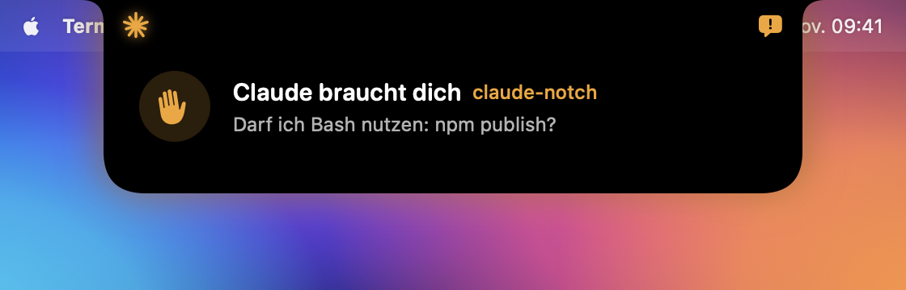 | 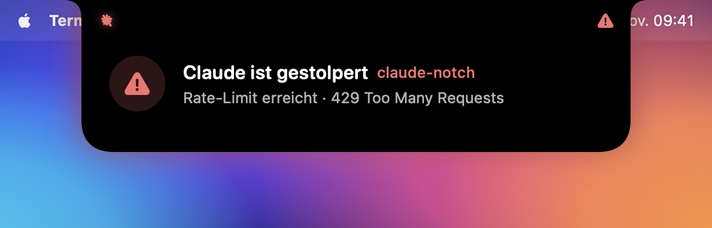 |
| 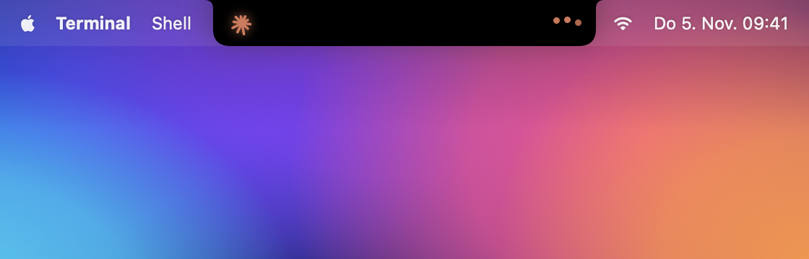 | 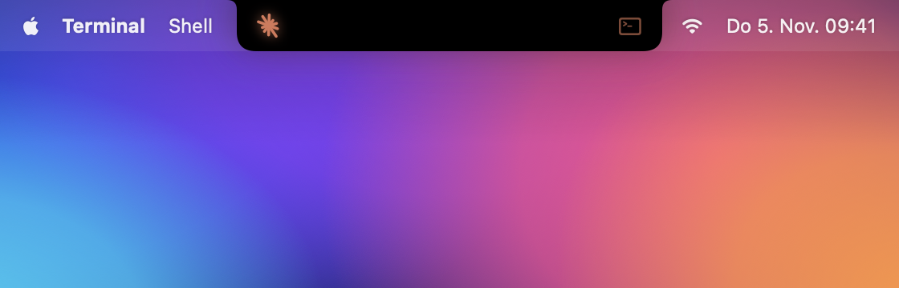 |
| 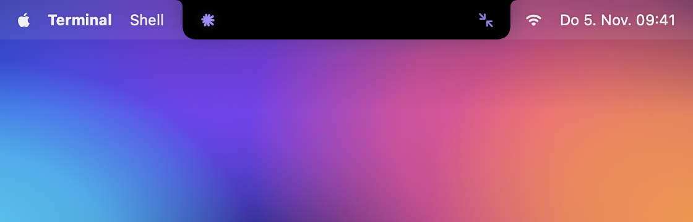 | |

## GIFs neu aufnehmen

```bash
./scripts/record-gifs.sh            # alle
./scripts/record-gifs.sh done error # nur diese
```

Braucht `ffmpeg` (`brew install ffmpeg`). Unten links erscheint kurz ein kleines Fenster, das
aufgenommen wird. Die Szenen und der Zeitpunkt jedes Screenshots stehen in `Sources/ClaudeNotch/Recorder.swift`.
