# Every animation

Each animation with the Claude Code hook that triggers it (Codex sends the same hooks, see [Codex](#codex)). All GIFs are real recordings of the app
(`./scripts/record-gifs.sh`); only the desktop behind it is staged.

[Thinking](#thinking) · [Working](#working) · [Needs you](#needs-you) · [Done](#done) · [Error](#error) ·
[Compacting](#compacting) · [Unseen](#unseen) · [All sessions](#all-sessions-hover) · [Codex & Cursor](#codex--cursor) · [Usage](#usage-limits) · [Music](#music) · [Back to music](#back-to-music) ·
[Nosy](#nosy) · [Level up](#level-up) · [Reply](#reply-from-the-notch) · [Shelf & AirDrop](#shelf--airdrop) · [Meeting](#meeting) · [Focus](#focus-timer) · [Clock](#clock) ·
[Charging](#charging) · [AirPods](#airpods) · [Full run](#full-run)

## Thinking


**Trigger:** `UserPromptSubmit`, `PostToolUse`

The notch slides out sideways. On the left the spark rotates and its rays pulse like a wave, on the right three dots bounce.

## Working

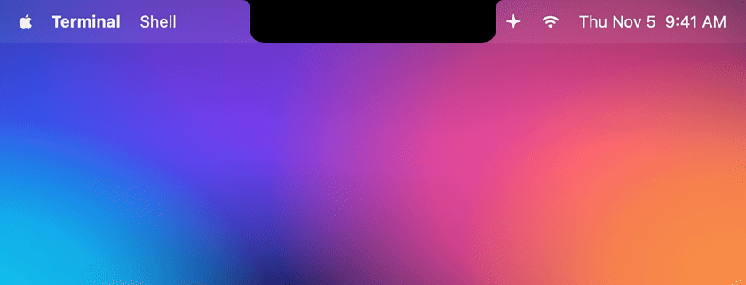

**Trigger:** `PreToolUse`

The spark spins faster and the right wing shows the tool's icon:

| Tool | Icon | Tool | Icon |
|---|---|---|---|
| Bash | terminal | Grep / Glob | magnifier / folder |
| Edit / Write | pencil | WebFetch / WebSearch | globe / compass |
| Read | document | Task / Agent | two people |
| TodoWrite | checklist | MCP tools | puzzle piece |

The hover list also says *what* is happening ("Editing Parser.swift", "Running · Run tests").

## Needs you

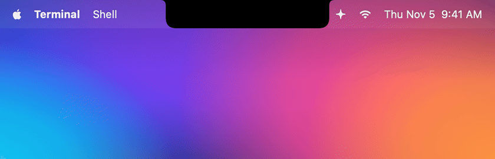

**Trigger:** `PermissionRequest` (the moment the permission dialog opens) and `Notification` (questions, MCP input …)

The notch opens with an amber glow and a shake, a hand waves, and the "Funk" sound plays. The message says which tool
and command Claude wants to run, with **Deny** / **Allow** buttons underneath (and **Always allow** when Claude Code
suggests a rule). Click one and the agent continues. With head gestures on (Settings → Permissions) and AirPods in, the hint
changes to "Nod to allow · shake to deny". If you answer in the terminal instead, the notch closes by itself. The "waiting for your
input" reminder Claude Code sends ~60 s after a finished turn is ignored on purpose.

## Done

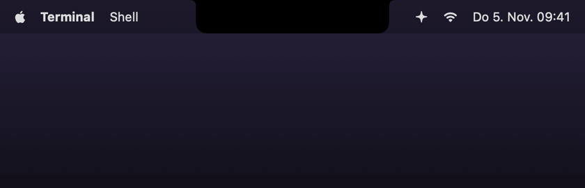

**Trigger:** `Stop`

A checkmark draws itself, confetti bursts, green glow, "Glass" sound. Shows the project, how long the turn took and the start
of Claude's last answer. Click to jump to the terminal, ✕ to close.

**Already in that app?** If the app the session runs in is in front (the Claude app, your terminal, VS Code, ChatGPT …),
there is no big card and no sound – just a green check in the compact notch for three seconds. The same goes for
*Needs you*: the compact notch shows the amber bubble and the app's own prompt takes the question
(Settings → Notifications to turn this off):

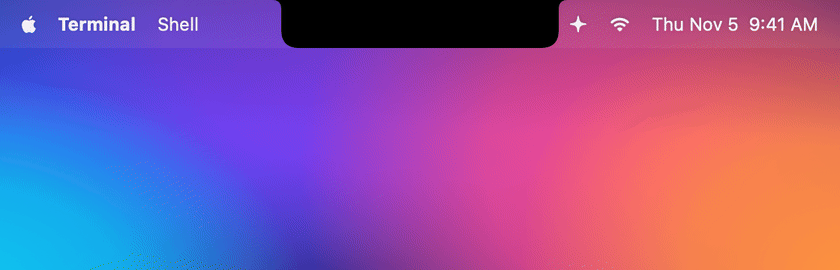

## Unseen

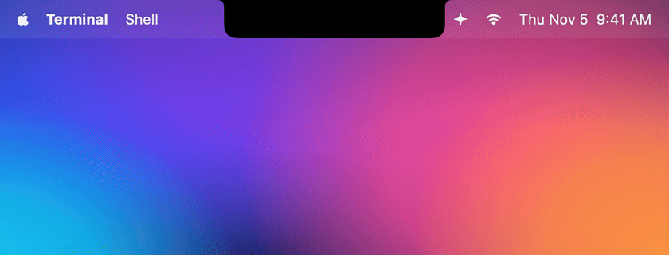

**Trigger:** `Stop` while you weren't looking

If a turn finishes and you don't switch to that app, hover the list or click the card, a green dot breathes in the notch
(on the cover while music plays, next to the session in the hover list). After five minutes it reminds you once more with
a softer sound – the same goes for a question nobody answered (Settings → Alerts).

## Error


**Trigger:** `StopFailure` (the turn ended because of an API error)

Red glow, a sputtering spark and a twitching warning sign, "Basso" sound. The error code is translated:

| `error` | Shown as |
|---|---|
| `rate_limit` | Rate limit reached |
| `overloaded` | API is overloaded |
| `authentication_failed` | Authentication failed |
| `billing_error` | Billing problem |
| `server_error` | API server error |
| `max_output_tokens` | Response hit the token limit |
| … | API error + details |

Failed *tools* (`PostToolUseFailure`, e.g. a red test) deliberately don't raise an alarm – that's everyday work and Claude
just carries on.

## Compacting


**Trigger:** `PreCompact`

A purple spark that turns backwards and contracts.

## All sessions (hover)


Move the pointer over the notch: a list of every session with status, current tool and timer. Click brings the right
terminal to the front, ✕ removes a session. With several sessions the compact notch always shows the most important one
(needs you / error > working > done > ready).

## Codex & Cursor


**Trigger:** the same hooks, sent by the Codex CLI or the Codex mode of the ChatGPT app (`~/.codex/hooks.json`).

Codex sessions get every animation above, with a blue spark and a small *Codex* badge. Codex tools have their own icons:
`apply_patch` shows a pencil and the files it changes, `update_plan` a checklist, `web_search` a compass. When you stop a
Codex turn with Esc, its `Interrupt` hook puts the session straight back to *Ready*. Codex has no `StopFailure` hook,
so the error animation is Claude-only for now.

**Cursor**'s agent (`~/.cursor/hooks.json`) shows up the same way with a silver spark: its `beforeSubmitPrompt`,
`preToolUse` and `stop` hooks become thinking, tools and done; a `stop` with status `aborted` or `error` becomes
*Ready* or the error animation. Terminal and MCP commands that leave Cursor's sandbox wait for Allow / Deny in the notch
(`beforeShellExecution` / `beforeMCPExecution`); ✕ or 45 s hand them back to Cursor's own prompt. The context ring comes
from the token count in `afterAgentResponse`.

## Usage limits

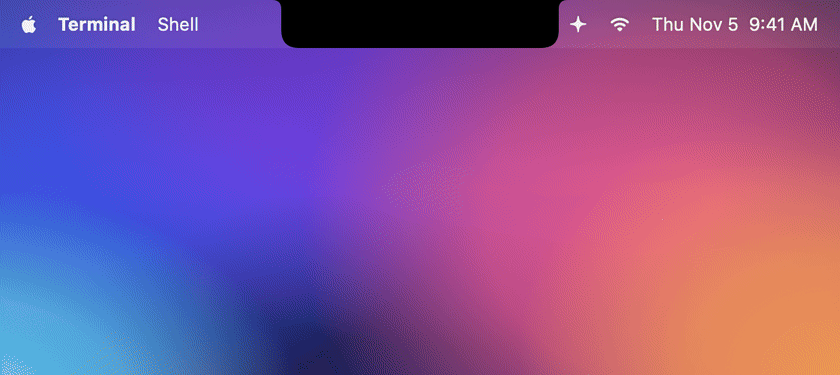

Shown at the bottom of the hover view: 5-hour and weekly limits for Claude (Pro / Max, via a silent status line) and Codex
(from its session files). Hover a bar to see when it resets.

## Limit reset

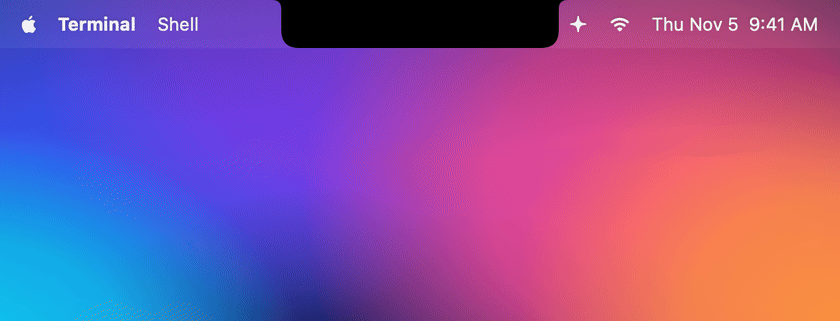

**Trigger:** a 5-hour or weekly limit that was at least 80 % used reaches its reset time

The ring drains back to empty while the arrow turns once: "Claude is ready again". Works with the last numbers the app
saw, so it also fires when the agent isn't running, and once after launch if the reset happened meanwhile. Turn it off
in Settings → Usage.

## Music

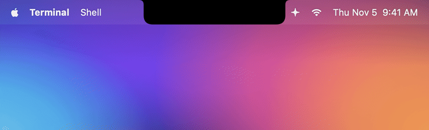

**Trigger:** Spotify or Apple Music is playing and no Claude session is working or waiting.

Cover on the left, four bars dancing in the cover's colour on the right (flat when paused). Hover opens the player: cover
(click opens the app), title, artist, progress (click or drag to seek) and previous / play-pause / next. The song and cover in
the GIFs are made up.

With **Live equalizer** on (Settings → Music) there are five bigger, glowing bars that follow the real music: bass left,
treble right, with automatic gain so quiet and loud songs both move. Until audio arrives (or without the macOS permission)
they dance a bouncier made-up beat.

## Back to music


Music plays → Claude gets a prompt and takes over the notch → "Done" → click ✕ → the notch shows the music again.
Without a click the same happens after 6 seconds.

## Nosy

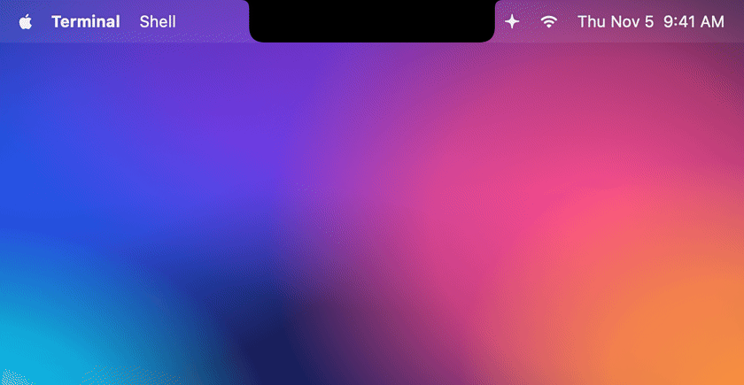

**Trigger:** the pointer, hover, a click – and every agent state above

Nosy's eyes sit in the left wing and follow the pointer. Close to the notch Nosy peeks out (energy ring on the right);
when the notch opens it drips out and hangs from the edge, a click makes it giggle, and when the notch closes it turns
black, squeezes and dives back in with a splash of tar drops. After 10 minutes without anything (2 at night) it sleeps.

## Level up


**Trigger:** `Stop` with enough XP

Every finished task feeds Nosy. Reaching a level shows a shiny "✦ Level N" on the done card and Nosy cheers.

## Reply from the notch

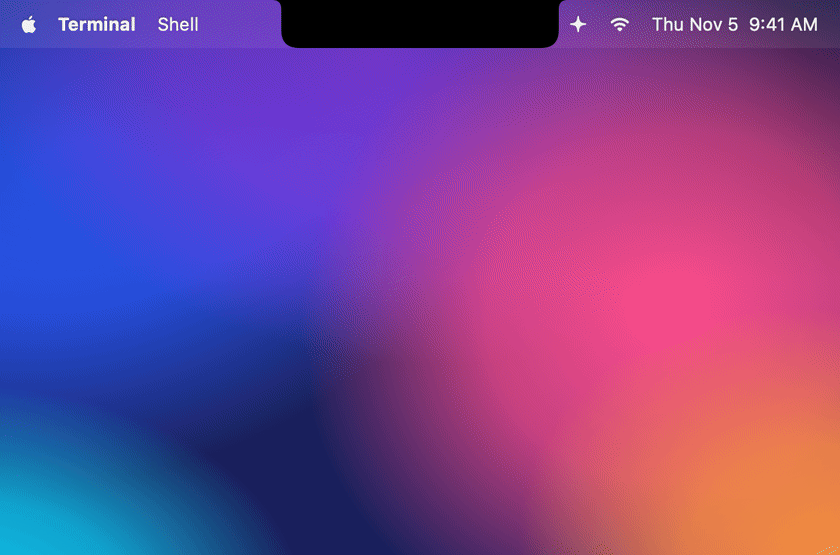

**Trigger:** "Reply" on the done card or the bubble next to a session

The conversation from the session's transcript, refreshed while open, and a reply field.

## Shelf & AirDrop

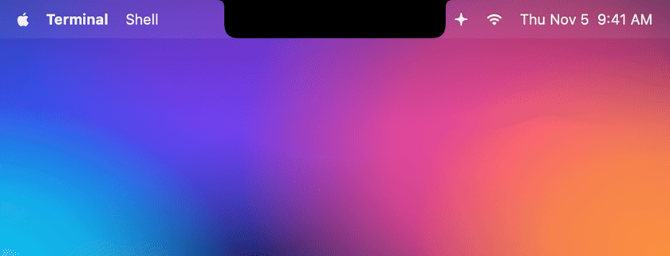

**Trigger:** dragging files near the notch

Two drop targets. Parked files show in the hover view:


## Meeting

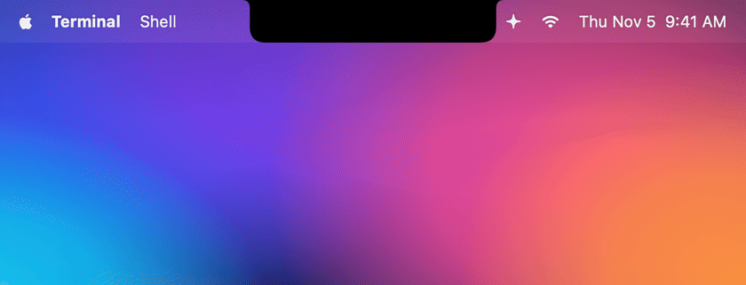

**Trigger:** 10 minutes before a calendar event (opt-in)

## Focus timer


**Trigger:** "25m" in the hover view or the menu bar

## Clock


**Trigger:** nothing else going on

With no agent working, no music, no focus timer and nothing unseen, the time sits on the right wing next to Nosy. The digits roll
when the minute changes, the colon breathes in Nosy's gold, and the clock dims while Nosy sleeps. Hover for the big clock and
the date. It follows your Mac's 12 / 24-hour setting and only shows under a real notch (Settings → Extras to turn it off).

## Charging

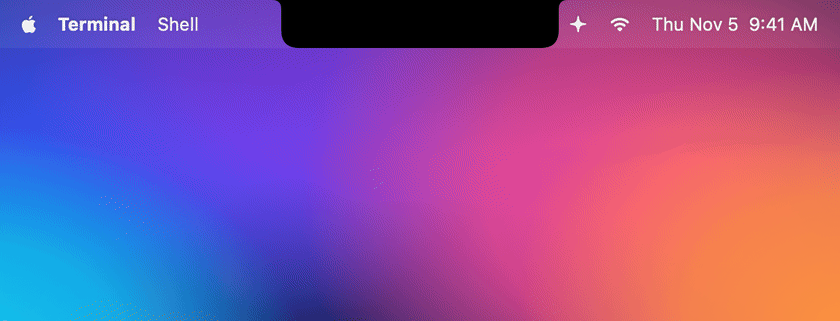

**Trigger:** plugging in (and a heads-up at 20 %)

## AirPods

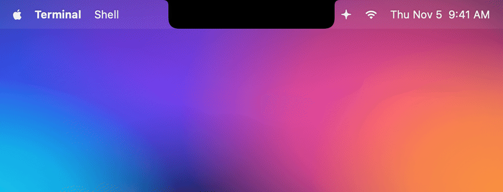

**Trigger:** Bluetooth headphones connecting (opt-in)

## Full run

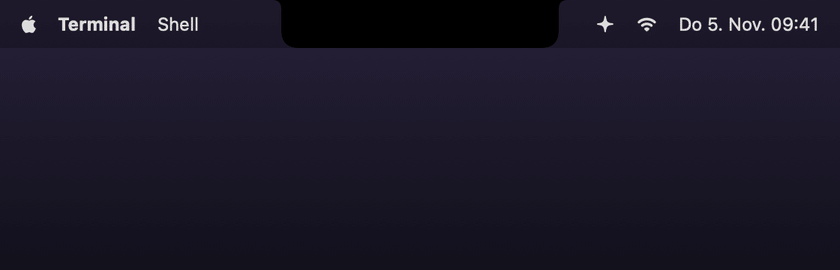

Thinking → Grep → Edit → permission for Bash → tests run → done. Play it live with `npx nosynotch demo`.

## Settings window

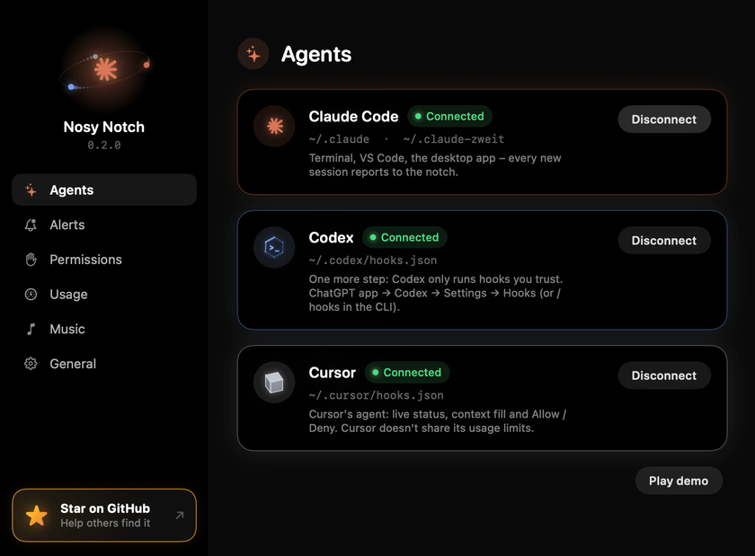

Recorded with `./scripts/record-gifs.sh settings`.

## Re-recording the GIFs

```bash
./scripts/record-gifs.sh             # all scenes
./scripts/record-gifs.sh done error  # only these
```

Needs `ffmpeg` (`brew install ffmpeg`). A small window shows up in the bottom-left corner while recording – leave it
uncovered. The scenes live in `Sources/NosyNotch/Recorder.swift`. `STILLS=1` also saves a PNG of each fully expanded notch
to `docs/screenshots/`.
