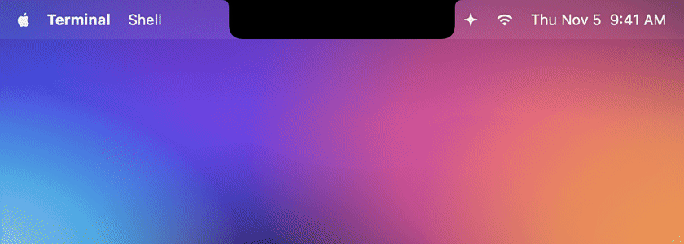
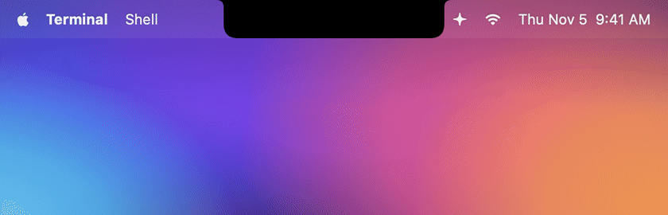

# Every animation

Each animation with the Claude Code hook that triggers it (Codex sends the same hooks, see [Codex](#codex)). All GIFs are real recordings of the app
(`./scripts/record-gifs.sh`); only the desktop behind it is staged.

[Thinking](#thinking) · [Working](#working) · [Needs you](#needs-you) · [Done](#done) · [Error](#error) ·
[Compacting](#compacting) · [All sessions](#all-sessions-hover) · [Codex](#codex) · [Music](#music) · [Back to music](#back-to-music) ·
[Full run](#full-run)

## Thinking


**Trigger:** `UserPromptSubmit`, `PostToolUse`

The notch slides out sideways. On the left the spark rotates and its rays pulse like a wave, on the right three dots bounce.

## Working


**Trigger:** `PreToolUse`

The spark spins faster and the right wing shows the tool's icon:

| Tool | Icon | Tool | Icon |
|---|---|---|---|
| Bash | terminal | Grep / Glob | magnifier / folder |
| Edit / Write | pencil | WebFetch / WebSearch | globe / compass |
| Read | document | Task / Agent | two people |
| TodoWrite | checklist | MCP tools | puzzle piece |

The hover list also says *what* is happening ("Editing Parser.swift", "Running · Run tests").

## Needs you


**Trigger:** `PermissionRequest` (the moment the permission dialog opens) and `Notification` (questions, MCP input …)

The notch opens with an amber glow and a shake, a hand waves, and the "Funk" sound plays. The message says which tool
and command Claude wants to run. As soon as you answer in the terminal, the notch closes by itself. The "waiting for your
input" reminder Claude Code sends ~60 s after a finished turn is ignored on purpose.

## Done


**Trigger:** `Stop`

A checkmark draws itself, confetti bursts, green glow, "Glass" sound. Shows the project, how long the turn took and the start
of Claude's last answer. Click to jump to the terminal, ✕ to close.

## Error


**Trigger:** `StopFailure` (the turn ended because of an API error)

Red glow, a sputtering spark and a twitching warning sign, "Basso" sound. The error code is translated:

| `error` | Shown as |
|---|---|
| `rate_limit` | Rate limit reached |
| `overloaded` | API is overloaded |
| `authentication_failed` | Authentication failed |
| `billing_error` | Billing problem |
| `server_error` | API server error |
| `max_output_tokens` | Response hit the token limit |
| … | API error + details |

Failed *tools* (`PostToolUseFailure`, e.g. a red test) deliberately don't raise an alarm – that's everyday work and Claude
just carries on.

## Compacting


**Trigger:** `PreCompact`

A purple spark that turns backwards and contracts.

## All sessions (hover)


Move the pointer over the notch: a list of every session with status, current tool and timer. Click brings the right
terminal to the front, ✕ removes a session. With several sessions the compact notch always shows the most important one
(needs you / error > working > done > ready).

## Codex



**Trigger:** the same hooks, sent by the Codex CLI or the Codex mode of the ChatGPT app (`~/.codex/hooks.json`).

Codex sessions get every animation above, with a blue spark and a small *Codex* badge. Codex tools have their own icons:
`apply_patch` shows a pencil and the files it changes, `update_plan` a checklist, `web_search` a compass. When you stop a
Codex turn with Esc, its `Interrupt` hook puts the session straight back to *Ready*. Codex has no `StopFailure` hook,
so the error animation is Claude-only for now.

## Music


**Trigger:** Spotify or Apple Music is playing and no Claude session is working or waiting.

Cover on the left, four bars dancing in the cover's colour on the right (flat when paused). Hover opens the player: cover
(click opens the app), title, artist, progress (click or drag to seek) and previous / play-pause / next. The song and cover in
the GIFs are made up.

## Back to music



Music plays → Claude gets a prompt and takes over the notch → "Done" → click ✕ → the notch shows the music again.
Without a click the same happens after 6 seconds.

## Full run


Thinking → Grep → Edit → permission for Bash → tests run → done. Play it live with `npx nosynotch demo`.

## Re-recording the GIFs

```bash
./scripts/record-gifs.sh             # all scenes
./scripts/record-gifs.sh done error  # only these
```

Needs `ffmpeg` (`brew install ffmpeg`). A small window shows up in the bottom-left corner while recording – leave it
uncovered. The scenes live in `Sources/NosyNotch/Recorder.swift`. `STILLS=1` also saves a PNG of each fully expanded notch
to `docs/screenshots/`.
